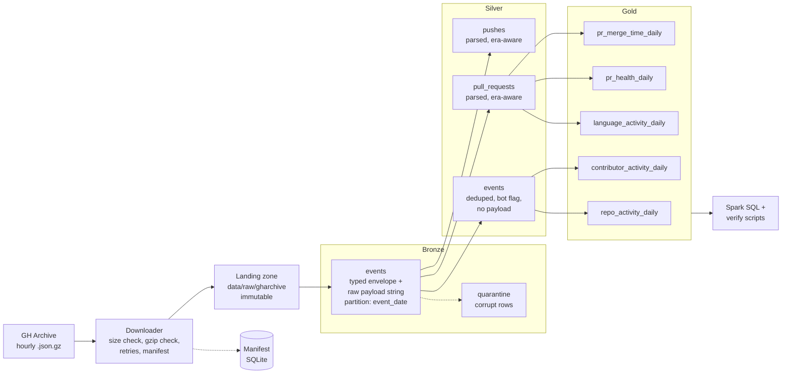

# Octopulse Lakehouse: a PySpark medallion pipeline for GitHub activity

A batch data pipeline that ingests hourly [GH Archive](https://www.gharchive.org/) files (public GitHub events), refines them through **Bronze → Silver → Gold** Parquet layers with PySpark, and publishes analytics tables for repository activity, language activity, pull-request health and contributor behaviour.

The project is built around a real upstream problem: **GitHub changed its Events API payloads on 2025-10-07**, removing fields such as commit counts on pushes and the `merged` flag on pull requests. The pipeline handles both schema "eras" in one codebase and is explicit about which metrics exist in which era.

> **Status:** Bronze, Silver and Gold are complete and verified on 8 days of data. The performance study (skew and shuffle experiments) and the presentation layer (charts) are the next steps; see [Roadmap](#roadmap).

---

## Contents

1. [What this project demonstrates](#what-this-project-demonstrates)
2. [Data](#data)
3. [Architecture](#architecture)
4. [Layers in detail](#layers-in-detail)
5. [Gold tables and metric definitions](#gold-tables-and-metric-definitions)
6. [Findings](#findings)
7. [Engineering decisions](#engineering-decisions)
8. [Data quality and testing](#data-quality-and-testing)
9. [Performance](#performance)
10. [Run it yourself](#run-it-yourself)
11. [Example queries](#example-queries)
12. [Repository structure](#repository-structure)
13. [Limitations](#limitations)
14. [Roadmap](#roadmap)
15. [References](#references)

---

## What this project demonstrates

| Skill | Where to look |
|---|---|
| Medallion architecture with explicit schemas | `src/ghpipe/bronze.py`, `schemas/payloads.py` |
| Schema evolution handled in code, not by hand | One payload schema serves both eras; `payload_era` and `merged_known` flags |
| Idempotent, day-level reprocessing | Dynamic partition overwrite, partial-day guard in `scripts/run_bronze.py` |
| Reliable ingestion | `extract/download.py`: size check, gzip integrity check, atomic rename, retries, SQLite manifest |
| Spark performance reasoning | Parse-before-dedup cut Silver from 2h 19m to about 19 min ([details](#performance)) |
| Window functions done correctly | `rangeBetween` on day numbers plus a coverage calendar ([details](#engineering-decisions)) |
| Honest metric design | NULL means "cannot know"; inferred values are flagged; limitations are documented |
| Testing and verification | pytest with hand-written fixtures, per-layer reconciliation, `verify_*` scripts |

---

## Data

| Item | Detail |
|---|---|
| Source | [GH Archive](https://www.gharchive.org/): hourly archives of the public GitHub event timeline |
| URL pattern | `https://data.gharchive.org/YYYY-MM-DD-H.json.gz` (the hour is **not** zero-padded) |
| Format | One gzip-compressed JSON file per UTC hour, one event per line |
| Event types in scope | `PushEvent`, `PullRequestEvent`, `WatchEvent` (star actions), `ForkEvent` |
| Documentation | [GitHub event types](https://docs.github.com/en/rest/using-the-rest-api/github-event-types) |
| Licence | No explicit licence statement was found on the GH Archive pages reviewed. The data is public GitHub activity subject to GitHub's terms. **Raw data is not redistributed** in this repository (`data/` is gitignored). |

### The two eras

GitHub [announced](https://github.blog/changelog/2025-08-08-upcoming-changes-to-github-events-api-payloads/) on 2025-08-08 that Events API payloads would be trimmed on 2025-10-07. This project loads one window on each side:

| Era | Label | Days loaded | Weekdays | Payload |
|---|---|---|---|---|
| A | `A_full` | 2025-08-13 to 2025-08-17 (5 consecutive days) | Wed, Thu, Fri, Sat, Sun | Full payloads |
| B | `B_trimmed` | 2026-09-15 to 2026-09-17 (3 consecutive days) | Tue, Wed, Thu | Trimmed payloads |

**What actually differs between the eras (measured on these days):**

| Field / signal | Era A | Era B |
|---|---|---|
| Push `commits[]`, `size`, `distinct_size` | Present (100% of pushes) | **Absent** (0%) |
| Pull-request `merged` flag | Present (100% of PR events) | **Absent** (0%) |
| Pull-request `base.repo.language` | Present on 90.7% of PR events | **Absent** (0%) |
| PR actions | `opened`, `closed`, `reopened` | Adds `merged` (a distinct action), `labeled`, `unlabeled`, `assigned`, `unassigned` |

Volume: **17,832,852** in-scope events after deduplication (13,771,413 in Era A, 4,061,439 in Era B).

---

## Architecture



Note: `silver/pushes` is built and tested, but no Gold table uses it yet.

---

## Layers in detail

### Extraction (`src/ghpipe/extract/download.py`, `manifest.py`)

- Generates the 24 expected hourly URLs per day from a `--start`/`--end` date range.
- For each hour: HEAD request for the expected size, download to `*.part`, verify the byte count and gzip integrity, then atomically rename.
- Retries with exponential backoff. Hours that return 404 are recorded as `MISSING`.
- A **SQLite manifest** records hour, URL, status, expected and actual bytes, SHA-256, attempts and timestamp. A rerun downloads only what is missing or no longer matches the manifest.

### Bronze (`src/ghpipe/bronze.py`)

- Reads raw JSON with an **explicit schema** (never `inferSchema`) in `PERMISSIVE` mode with a corrupt-record column.
- Keeps the **envelope typed** (`id`, `type`, `actor`, `repo`, `public`, `created_at`) and the **`payload` as a raw JSON string**, so payload drift cannot break ingestion.
- Adds lineage columns: `source_file`, `event_hour`, `ingest_ts`.
- `event_date` comes from the **file name**, not from `created_at` (see [decisions](#engineering-decisions)).
- Filters to the four in-scope event types, routes corrupt rows to `data/quarantine`, writes Parquet partitioned by `event_date` with dynamic partition overwrite.
- Reconciles per day: `raw rows = in-scope + out-of-scope + corrupt`, and verifies what was written.

### Silver (`src/ghpipe/silver/`)

| Table | Grain | Purpose |
|---|---|---|
| `events` | one row per event | Typed, deduplicated, bot-flagged, era-labelled. **No payload column.** |
| `pull_requests` | one row per PR event | Parsed payload: action, number, outcome, language, timestamps |
| `pushes` | one row per push event | Parsed payload: push id, ref, head SHA, sizes where present |

Key steps: flatten structs, deduplicate on `event_id` (deterministic survivor), `is_bot` flag, `payload_era` label, `from_json` parsing with a schema covering both eras (absent fields become NULL).

**PR outcome mapping**

| Era | Action | Condition | `pr_outcome` |
|---|---|---|---|
| A | `closed` | `merged = true` | `merged` |
| A | `closed` | `merged = false` | `closed_unmerged` |
| B | `merged` | n/a | `merged` |
| B | `closed` | no merged flag | `closed_unmerged`, with `outcome_inferred = true` |

The Era B inference rests on one measurement: of 17,379 Era B `closed` PRs, only 114 (0.7%) also have a `merged` event for the same PR on the same day. See [Limitations](#limitations) for why this is still an inference.

### Gold (`src/ghpipe/gold/`)

Five tables with fixed grains, documented below. Every table is reconciled back to Silver per day before the run is allowed to finish.

---

## Gold tables and metric definitions

All tables are Parquet, partitioned by `event_date`, and carry `payload_era`.

| Table | Grain | Rows | Answers |
|---|---|---|---|
| `repo_activity_daily` | day × repo | 4,531,901 | Which repos are active or accelerating? Who dominates? |
| `language_activity_daily` | day × language | 1,354 | How is PR activity distributed across languages? |
| `pr_health_daily` | day × repo | 758,291 | How many PRs open, merge, close unmerged? |
| `contributor_activity_daily` | day × actor | 3,197,467 | Who is active? How much is automated? |
| `pr_merge_time_daily` | day × is_bot | 10 | How long do PRs take to merge (PR-level percentiles)? |

<details>
<summary>Column reference</summary>

**`repo_activity_daily`**: `event_date`, `payload_era`, `repo_id`, `repo_name`, `total_events`, `push_events`, `fork_events`, `star_events`, `pr_events`, `bot_events`, `human_events`, `distinct_actors`, `distinct_pushers`, `star_events_window`, `star_events_prior_window`, `star_delta`, `star_velocity`, `velocity_window_days`, `velocity_history_complete`, `trending_rank`

**`language_activity_daily`**: `event_date`, `payload_era`, `language` (includes an explicit `UNKNOWN` bucket), `active_repos`, `pr_events`, `pr_opened_events`, `pr_opened_human_events`, `distinct_contributors`, `is_known_language`, `share_of_pr_events`, `language_coverage`

**`pr_health_daily`**: `event_date`, `payload_era`, `repo_id`, `pr_events`, `prs_opened`, `prs_opened_by_humans`, `prs_merged`, `prs_closed_unmerged`, `prs_closed_unknown`, `prs_closed`, `merge_rate`

**`contributor_activity_daily`**: `event_date`, `payload_era`, `actor_id`, `actor_login`, `is_bot`, `events_total`, `push_events`, `pr_events`, `repos_touched`, `first_seen_date`, `is_new_contributor`

**`pr_merge_time_daily`**: `event_date`, `payload_era`, `is_bot` (actor of the closing event), `merged_prs_with_times`, `p25_hours`, `p50_hours`, `p75_hours`, `p90_hours`
</details>

### Metric definitions

| Metric | Definition | Caveat |
|---|---|---|
| `star_events` | Count of `WatchEvent`s for a repo in a UTC day | Star **actions**, not a repo's total stars |
| `star_velocity` | `star_events_window / star_events_prior_window` | **Day-over-day** (window = 1 day) because Era B has only 3 consecutive days. NULL unless the lookback days are loaded and the prior period has at least 5 stars. `star_delta` gives the absolute change. |
| `merge_rate` | `prs_merged / prs_closed` for PRs that ended that day | Close-date basis. NULL if any closed PR has unknown merge status. Era B values rest on the inferred mapping. |
| `p50_hours` etc. | Percentiles of `merged_at − pr_created_at` across **PRs merged that day** | Era A only (Era B has no merge timestamps). Long-lived PRs appear only when they finally merge. |
| `is_bot` | Actor login ends in `[bot]`, or is listed in `config/known_bots.csv` | A strict **lower bound**: scripted accounts without the suffix are not caught |
| `language_coverage` | Share of that day's PR events that have a known language | Language exists only in Era A, and only on PR payloads |
| `is_new_contributor` | First seen on this day within the loaded days of the era | NULL on the first loaded day. The share decays as more days are loaded, so it is **not** a growth measure. |

---

## Findings

All numbers come from the verification scripts on the 8 loaded days. Treat cross-era comparisons as **observations**: the eras are 13 months apart and also differ in schema.

### 1. Era A has about twice Era B's volume, even on matched weekdays

The two windows contain different weekdays, so only Wednesday and Thursday are directly comparable:

| Metric | Era A Wed (08-13) | Era A Thu (08-14) | Era B Wed (09-16) | Era B Thu (09-17) |
|---|---|---|---|---|
| In-scope events | 2,751,783 | 2,694,880 | 1,360,321 | 1,428,644 |
| Bot share of events | 25.9% | 25.8% | 16.1% | 17.8% |
| Top-10 repos' share of events | 3.0% | 2.6% | 1.0% | 1.4% |
| Active actors | 517,692 | 504,961 | 285,321 | 333,472 |

The ratio is about 2.0x on Wednesday and 1.9x on Thursday. Across all loaded days, per-day averages are lower in Era B for every event type: pushes −54%, stars −65%, forks −65%, PR events −11% (inflated in Era B by label and assignment events). The data cannot say why; plausible causes include platform or API changes, spam cleanup and seasonality.

### 2. Skew is at the actor level, not the repo level

- The top 10 repos hold only 0.9–5.5% of events on any day.
- Accounts flagged as bots are **0.22–0.26% of actors but 25.8–29.7% of events** in Era A (0.71–0.89% of actors and 16–18% of events in Era B), roughly 140x the per-actor volume in Era A (rough arithmetic).
- The `[bot]` suffix undercounts automation: several of the highest-volume repos (for example, repos with 14,000–17,000 pushes per day) show zero bot-flagged events.

### 3. Pull requests

- **Merges by bots:** 23.8–28.6% of merged PRs in Era A are closed by bot-flagged accounts, with a median merge time of **4 seconds**.
- **Human merge time (Era A):** weekday median 5–7 minutes, p75 7–11 hours, p90 65–72 hours. Weekend median is about 1.4–1.6 minutes with p75 about 1.1–1.3 hours. A likely explanation (not proven) is that weekday PRs wait for review while weekend merges are mostly quick solo work.
- **A metric that misled:** an early per-repo "median of medians" gave about 1 minute; the PR-level table shows a human weekday median several times higher. Aggregating medians across tiny repos is not meaningful.
- **Merge rate:** 76.6–80.4% in Era A; 92.0–92.5% in Era B. Do **not** compare these: per day, Era B has about 78% fewer unmerged closes than Era A but only about 25% fewer merges, which suggests either a real behaviour change or incomplete `closed` events in Era B.

### 4. Language activity (Era A only)

Coverage is 88–92% of PR events (lower on the weekend). By PR events, TypeScript leads (about 17–18%), then Python (about 13%) and JavaScript (about 9–10%). These counts include bot PRs; use `pr_opened_human_events` for a human-only view. Era B has no language data, so the table holds only an `UNKNOWN` bucket for those days.

### 5. Trending repositories

Day-over-day star velocity surfaces real spikes (for example, 166 stars against 6 the day before) but is easily dominated by small bases and promotion-like bursts (one repo went from 8 to 402 stars in a day). Both `star_velocity` and `star_delta` are published, and velocity is NULL below a minimum prior volume. Velocities are not comparable across eras because Era B has far fewer stars overall.

---

## Engineering decisions

| Decision | Choice | Reason |
|---|---|---|
| Partition date | `event_date` = **file** date in every layer; precise time in `event_ts` | Dynamic overwrite replaces whole partitions. Partitioning by `created_at` could let a reprocessed day overwrite the next day with a few straggler rows. Measured mismatch between file date and event date: 0.0 |
| Bronze payload | Typed envelope + **raw payload string** | Survives payload drift; Silver can be rebuilt from Bronze |
| Raw landing zone | Keep the original `.json.gz` files untouched | Replay and audit without re-downloading |
| File format | Parquet | Columnar, compressed, schema-carrying, prunable |
| Reprocessing unit | One UTC day; a guard refuses to overwrite a date unless all 24 hourly files are present | A partial day would silently erase the rest of the partition |
| Silver `events` | **Payload dropped** | Smaller and cheaper to shuffle; also keeps commit author emails (present in Era A push payloads) out of Silver |
| Dedup order | **Parse before dedup** for typed tables; filter and prune before any shuffle | Payload strings never enter the window shuffle. Silver went from 8,362 s to about 1,137 s with identical row counts |
| Dedup method | `row_number()` over `event_id`, ordered by file then ingest time | Deterministic survivor; `dropDuplicates` keeps an arbitrary row |
| Bots | A flag (`[bot]` suffix or known-bots list via broadcast join), never a delete | Reversible; both views stay available |
| Era handling | One payload schema with nullable fields; `payload_era` (from date) and `merged_known` (from the field) | Two independent signals that must agree (verified 100%) |
| Aggregation style | Conditional aggregation (`sum(when(...))`) instead of `pivot` | One scan, explicit column names |
| Rolling windows | `rangeBetween` on a day number, gated by a **coverage calendar** | Days without activity have no rows, so row-based windows span the wrong period. Velocity is NULL when lookback days are not loaded (including across the 13-month gap between eras) |
| NULL semantics | NULL means "cannot know", never zero | `merge_rate` and `star_velocity` are NULL rather than misleading |
| Gold marts | Each mart owns its own metrics; no joins between marts | Avoids a large join over a heavy-tailed key |
| Lookback | Gold reads extra history, computes, then writes only the requested date range | Rolling metrics stay correct without overwriting other partitions |
| Verification | Reconcile each layer; read back what was written | Counts are checked against the previous layer before a run may finish |

---

## Data quality and testing

**Observed on the 8 loaded days**

| Check | Result |
|---|---|
| Corrupt records (Bronze) | 0 |
| Bronze reconciliation (`raw = in-scope + out-of-scope + corrupt`) | Passed every day |
| Duplicate event IDs removed | 12 (6 on 2025-08-13, 3 each on 2026-09-16 and 2026-09-17); 0 across days after dedup |
| Null rate: `event_id`, `type`, `event_ts`, `actor_id`, `actor_login` | 0 |
| Null `repo_id` / `repo_name` | about 7 per million events (kept; repo-grain tables contain one NULL-repo bucket per day) |
| File date vs event time mismatch | 0.0 on all days |
| `payload_era` vs `merged_known` agreement | 100% (Era A: all true; Era B: all false) |
| PR payload parse failures | 0 |
| Gold grain uniqueness | All five tables unique on their keys |
| Gold vs Silver reconciliation | Passed; human + bot merge counts equal `prs_merged` on every Era A day |

**Tests** (`uv run pytest`): hand-written fixtures covering hour-key generation, gzip truncation detection, the manifest, Bronze counting/quarantine/idempotency/filename-based dates, Silver dedup/bot flag/PR outcomes/era flags/payload dropping, and Gold velocity (including gap days and low volume), merge-rate NULL handling, language `UNKNOWN` bucket, new-contributor flags and PR-level merge time. Tests start real Spark jobs, so the full suite takes several minutes.

---

## Performance

Local mode, 4 cores, 6 GB driver memory. Each figure is a single run on a shared laptop; **run-to-run variance of up to about 2x was observed on unchanged code** (Gold: 951 s, 1,552 s and 1,972 s), so read these as orders of magnitude.

| Stage | Result |
|---|---|
| Bronze | 126–720 s per day (6 days measured; 2,539 s total). Era A days are slower, probably because push payloads carry commit arrays (hypothesis) |
| Silver, before parse-before-dedup | 8,362 s (2 h 19 m) for 8 days |
| Silver, after | **1,137 s (about 19 min)** for 8 days (3.1–11.8x faster per day), identical row counts |
| Gold (4–5 tables, full range) | 951–1,972 s depending on the run |

| Storage (fill in with `du -sh data/*`) | Size |
|---|---|
| Raw `.json.gz` (landing) | TODO |
| Bronze | TODO |
| Silver | TODO |
| Gold | TODO |

Silver's speedup is attributed to removing the payload column from the dedup shuffle. This is consistent with the result but the shuffle sizes were not measured.

---

## Run it yourself

**Requirements:** Java (a version supported by your PySpark release), Python, and [uv](https://docs.astral.sh/uv/). Developed against PySpark 4.x on Linux.

```bash
# 1. Install dependencies
uv sync

# 2. Download (about 2 GB per Era A day; failed or truncated files are detected and refetched)
PYTHONPATH=src uv run python -m ghpipe.extract.download --start 2025-08-13 --end 2025-08-17
PYTHONPATH=src uv run python -m ghpipe.extract.download --start 2026-09-15 --end 2026-09-17

# 3. Build the layers
uv run python scripts/run_bronze.py                      # or: --days 2025-08-13 2025-08-14
uv run python scripts/run_silver.py                      # or: --days ...
uv run python scripts/run_gold.py                        # always run on the full range

# 4. Verify
uv run python scripts/verify_silver.py
uv run python scripts/verify_gold.py

# 5. Tests
uv run pytest
```

Notes:
- `data/` is gitignored. Raw files, Bronze, Silver and Gold all live under it.
- Bronze and Silver accept `--days`. Gold should always run over the full range, because rolling metrics and "first seen" depend on every loaded day.
- To add days, download them, run Bronze and Silver for those days only, then rerun Gold.
- Add logins to `config/known_bots.csv` (one per line, header `login`) to flag automated accounts without the `[bot]` suffix.

---

## Example queries

Register the Gold tables as views, then use Spark SQL:

```python
# PYTHONPATH=src uv run python
from ghpipe.spark import get_spark
spark = get_spark("explore")
for t in ["repo_activity_daily", "language_activity_daily", "pr_health_daily",
          "contributor_activity_daily", "pr_merge_time_daily"]:
    spark.read.parquet(f"data/gold/{t}").createOrReplaceTempView(t)
```

```sql
-- 1. Weekday-matched comparison: Wednesday and Thursday only (Spark: 1 = Sunday)
SELECT payload_era, event_date, date_format(event_date, 'E') AS weekday,
       SUM(total_events) AS events,
       ROUND(SUM(bot_events) / SUM(total_events), 3) AS bot_share
FROM repo_activity_daily
WHERE dayofweek(event_date) IN (4, 5)
GROUP BY payload_era, event_date
ORDER BY weekday, payload_era;

-- 2. Trending repositories on one day
SELECT repo_name, star_events_window, star_events_prior_window, star_delta,
       ROUND(star_velocity, 1) AS star_velocity
FROM repo_activity_daily
WHERE event_date = DATE '2025-08-16' AND trending_rank <= 10
ORDER BY trending_rank;

-- 3. PR time to merge, humans vs bots
SELECT event_date, is_bot, merged_prs_with_times,
       ROUND(p50_hours * 60, 1) AS median_minutes, ROUND(p75_hours, 2) AS p75_hours
FROM pr_merge_time_daily
ORDER BY event_date, is_bot;

-- 4. Most active languages by human-opened PRs (Era A)
SELECT language, SUM(pr_opened_human_events) AS human_prs_opened
FROM language_activity_daily
WHERE is_known_language
GROUP BY language
ORDER BY human_prs_opened DESC
LIMIT 10;
```

---

## Repository structure

```text
octopulse-lakehouse/
├── README.md
├── pyproject.toml
├── config/
│   └── known_bots.csv               # optional list of automated accounts (header: login)
├── scripts/
│   ├── m0_feasibility.py            # sampling script used to compare the two eras
│   ├── run_bronze.py                # --days supported; refuses partial days
│   ├── run_silver.py                # --days supported
│   ├── run_gold.py                  # --start / --end / --window-days
│   ├── verify_silver.py             # quality and finding queries for Silver
│   └── verify_gold.py               # grain checks and Gold summaries
├── src/ghpipe/
│   ├── spark.py                     # SparkSession factory (UTC, shuffle partitions, overwrite mode)
│   ├── manifest.py                  # SQLite download manifest
│   ├── bronze.py                    # raw JSON → Bronze Parquet + quarantine
│   ├── extract/download.py          # hourly downloader
│   ├── schemas/payloads.py          # PR and push payload schemas (both eras)
│   ├── silver/
│   │   ├── common.py                # load, dedup, bot flag, era label
│   │   ├── pull_requests.py
│   │   ├── pushes.py
│   │   └── pipeline.py              # per-day orchestration and reconciliation
│   └── gold/
│       ├── common.py                # day numbers, coverage calendar, Silver reader
│       ├── repo_activity.py
│       ├── language_activity.py
│       ├── pr_health.py
│       ├── pr_merge_time.py
│       ├── contributors.py
│       └── pipeline.py              # lookback, writes, reconciliation
├── tests/
│   ├── conftest.py                  # shared Spark fixture
│   ├── test_extract.py
│   ├── test_bronze.py
│   ├── test_silver.py
│   └── test_gold.py
└── data/                            # gitignored
    ├── raw/gharchive/               # landing zone
    ├── bronze/events/
    ├── quarantine/
    ├── silver/{events,pull_requests,pushes}/
    ├── gold/                        # the five Gold tables
    └── state/manifest.db
```

---

## Limitations

- **Small sample.** 8 days in two windows. Day-over-day velocity is the only rolling metric that fits; weekday-matched comparison covers just Wednesday and Thursday. These are descriptive comparisons with no confidence intervals.
- **Eras are 13 months apart and differ in schema.** Differences in volume or behaviour may come from seasonality, platform growth or the API change; the pipeline cannot separate them.
- **Era B merge outcomes are inferred.** The `closed` action is treated as closed-unmerged based on a 0.7% overlap with `merged` events. Unmerged closes fell about 78% per day against Era A while merges fell about 25%, so either behaviour changed or `closed` events are incomplete. Validating a sample against GitHub's REST API would settle it. Merge rates are not compared across eras.
- **Language is partial.** Only Era A, only via PR payloads, and 88–92% coverage within it.
- **Bot detection is a lower bound** (`[bot]` suffix plus an optional list). High-volume scripted accounts without the suffix are counted as human.
- **"New contributor" is relative to the loaded days** and decays as the window grows.
- **Time to merge** describes PRs merged on a given day, not PRs opened on that day, and exists only in Era A.
- **Timings are noisy** (single runs, up to about 2x variance on unchanged code).
- **Local mode only.** No cluster was used; at this size a single-node engine would also cope. Spark was chosen to practise distributed-processing design and because the same code scales out.
- **Privacy.** Era A push payloads contain commit author emails. They stay in the local Bronze payload strings only; Silver and Gold never extract them. Do not publish `data/`.
- **Licence.** No explicit data licence was found for GH Archive; the repository publishes code and aggregates only.

---

## Roadmap

1. **Performance study:** controlled benchmarks (idle machine, repeated runs), a shuffle-partition sweep, AQE on/off, and skew experiments on `actor_id` (the real hot key) including a salted two-stage aggregation; record file counts and sizes.
2. **Presentation layer:** a notebook rendering 6–8 charts from the Gold tables, plus saved SQL under `sql/`.
3. **More data (if downloads allow):** 2025-08-12 (Tuesday) would add a third matched weekday and six consecutive Era A days; Era B Friday to Sunday would allow a 3-day velocity window and weekend comparisons.
4. **Era B validation:** sample `closed` PRs against the GitHub REST API.
5. **Behavioural bot flag:** mark actors above a daily event threshold.
6. **Convenience:** a Makefile and CLI wrapper, `config/pipeline.yaml`, and optionally Delta Lake for `MERGE`-based upserts or an orchestrator.

---

## References

- GH Archive: <https://www.gharchive.org/>
- GitHub event types: <https://docs.github.com/en/rest/using-the-rest-api/github-event-types>
- GitHub changelog, 2025-08-08, upcoming Events API payload changes: <https://github.blog/changelog/2025-08-08-upcoming-changes-to-github-events-api-payloads/>
- Community reports on the payload changes: [#177111](https://github.com/orgs/community/discussions/177111) (`commits` removed from `PushEvent`), [#177735](https://github.com/orgs/community/discussions/177735) (trimmed `pull_request` payloads). These are user reports, not official documentation; this project verified the effects on its own data.
- Spark SQL performance tuning (AQE and skew handling): <https://spark.apache.org/docs/latest/sql-performance-tuning.html>